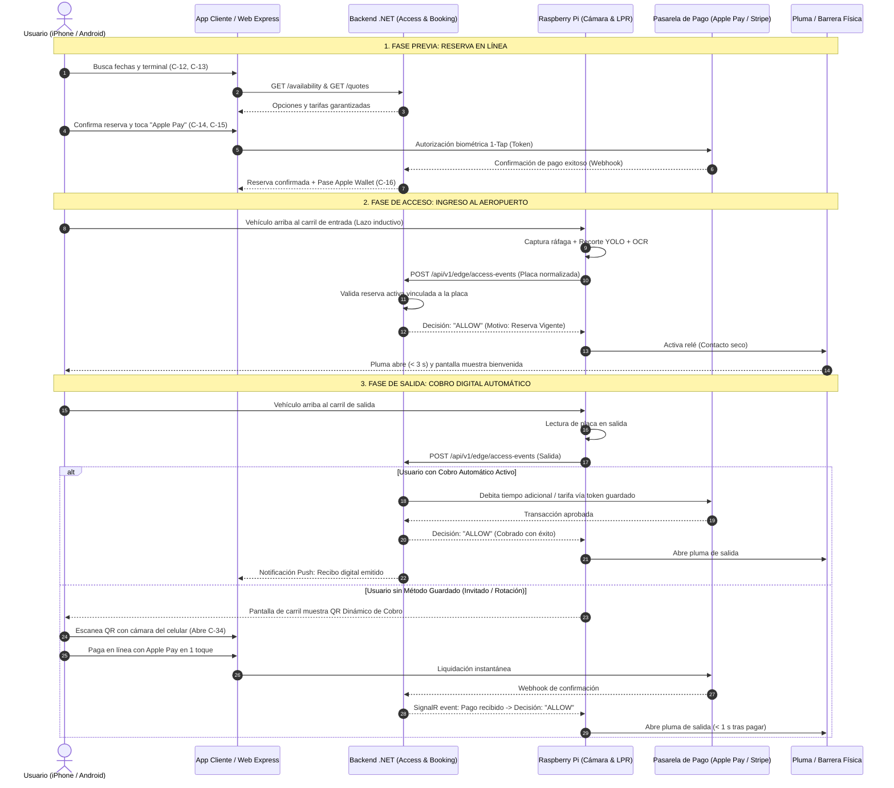
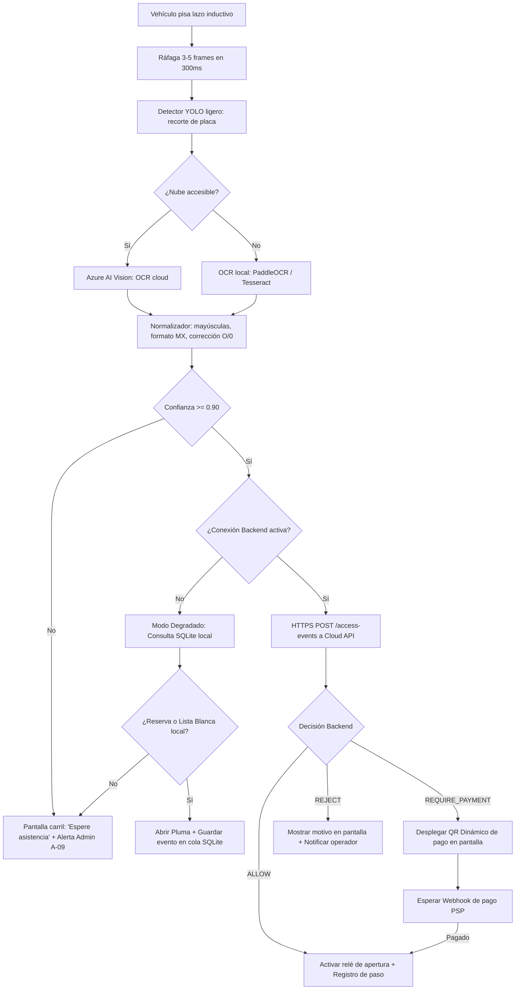
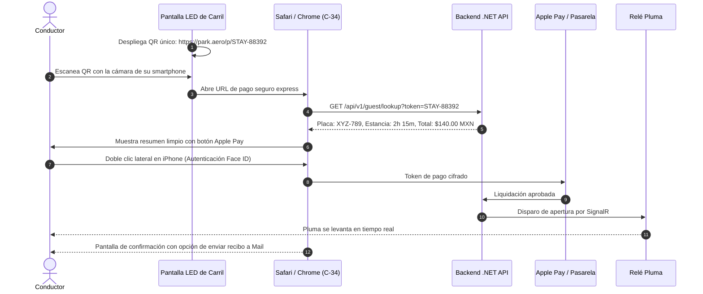

# Especificación Detallada de Pantallas y Flujos Operativos
## Estacionamiento Inteligente de Aeropuerto
**Diseño:** Minimalista con estilo editorial inspirado en los sitios web de Apple (apple.com) y Human Interface Guidelines (iOS / macOS)  
**Modelo Operativo:** 100% Digital & Cashless (Pagos exclusivamente en línea)  
**Versión de Especificación:** 2.0 · Octubre 2026  

---

## Tabla de Contenidos
1. [Arquitectura de Experiencia y Principios de Interacción](#1-arquitectura-de-experiencia-y-principios-de-interacción)
2. [Diagramas de Flujo de Punta a Punta (End-to-End)](#2-diagramas-de-flujo-de-punta-a-punta-end-to-end)
   - [2.1 Flujo Global del Cliente (Reserva, Acceso y Salida)](#21-flujo-global-del-cliente-reserva-acceso-y-salida)
   - [2.2 Flujo Técnico del Carril Edge (LPR + Decisión + Barrera)](#22-flujo-técnico-del-carril-edge-lpr--decisión--barrera)
   - [2.3 Flujo de Pago Express por QR Dinámico (Invitado)](#23-flujo-de-pago-express-por-qr-dinámico-invitado)
   - [2.4 Flujo de Alerta de Seguridad Policial (Zero Trust)](#24-flujo-de-alerta-de-seguridad-policial-zero-trust)
3. [Desglose Paso a Paso de los Flujos Principales](#3-desglose-paso-a-paso-de-los-flujos-principales)
4. [Especificación Detallada: App Cliente (Pantallas C-01 a C-34)](#4-especificación-detallada-app-cliente-pantallas-c-01-a-c-34)
   - [Grupo A: Entrada y Bienvenida (C-01 a C-08)](#grupo-a-entrada-y-bienvenida)
   - [Grupo B: Inicio y Vehículos (C-09 a C-11)](#grupo-b-inicio-y-vehículos)
   - [Grupo C: Reservas en Línea (C-12 a C-20)](#grupo-c-reservas-en-línea)
   - [Grupo D: Estancia Activa y Salida Digital (C-21 a C-24)](#grupo-d-estancia-activa-y-salida-digital)
   - [Grupo E: Métodos de Pago, Perfil y Privacidad (C-25 a C-32)](#grupo-e-métodos-de-pago-perfil-y-privacidad)
   - [Grupo F: Estados Globales y Pago Express Invitado (C-33 a C-34)](#grupo-f-estados-globales-y-pago-express-invitado)
5. [Especificación Detallada: Panel Administrativo (Pantallas A-01 a A-40)](#5-especificación-detallada-panel-administrativo-pantallas-a-01-a-a-40)
   - [Grupo A: Acceso y Estructura Base (A-01 a A-04)](#grupo-a-acceso-y-estructura-base)
   - [Grupo B: Operación en Vivo (A-05 a A-12)](#grupo-b-operación-en-vivo)
   - [Grupo C: Seguridad y Control Policial (A-13 a A-15)](#grupo-c-seguridad-y-control-policial)
   - [Grupo D: Finanzas y Conciliación Digital (A-16 a A-20)](#grupo-d-finanzas-y-conciliación-digital)
   - [Grupo E: Reservas y Clientes (A-21 a A-25)](#grupo-e-reservas-y-clientes)
   - [Grupo F: Configuración Avanzada (A-26 a A-33)](#grupo-f-configuración-avanzada)
   - [Grupo G: Auditoría, Reportes y Salud (A-34 a A-40)](#grupo-g-auditoría-reportes-y-salud)
6. [Matriz de Microinteracciones, Haptics y Estados de Sistema](#6-matriz-de-microinteracciones-haptics-y-estados-de-sistema)

---

## 1. Arquitectura de Experiencia, Principios de Interacción y Fundamentos Técnicos

### Filosofía de Diseño Minimalista y Estilo Web de Apple (apple.com & Apple HIG)
1. **Claridad Inmediata y Tipografía Monumental:** Inspirada en el ritmo visual y editorial de **apple.com**. Titulares audaces y grandes en **SF Pro Display** con interletrado negativo calibrado (`letter-spacing: -0.025em`), subtítulos elegantes en gris neutro (`#86868B`) y *Eyebrows* en mayúsculas condensadas en azul icónico Apple (`#0071E3`). La placa del vehículo, el saldo a pagar, el tiempo transcurrido y el código QR dinámico ocupan la zona focal sin ningún ruido gráfico.
2. **Espacio Negativo Expansivo (*Whitespace* generoso):** El diseño abraza el vacío como elemento estructural activo. Márgenes y separaciones amplias permiten que el contenido respire, eliminando divisiones pesadas y garantizando una lectura inmediata tanto en pantallas móviles en movimiento como en terminales de carril o consolas de escritorio.
3. **Estructura Bento Grid Asimétrica:** Organización de tableros, resúmenes y catálogos mediante retículas modulares estilo **Bento Grid** (idénticas a las presentaciones de producto en apple.com), con esquinas continuas tipo *Squircle* generosas ($24\text{ px}$ a $32\text{ px}$) y bordes milimétricos ultrafinos de $0.5\text{ px}$ con opacidad del $6\%$ en claro y $12\%$ en oscuro.
4. **Navegación Superior Translúcida (*Apple Global Nav*):** Barra fija (*Sticky Glass Navigation Bar*) de $44\text{ px}$ a $48\text{ px}$ con efecto de cristal esmerilado translúcido (*Ultra-thin frosted glass* con `backdrop-filter: blur(20px)` y transparencia controlada al $80\%$).
5. **Botones en Píldora (*Pill CTAs*) y Enlaces con Chevron:** Todos los botones de acción principal adoptan el formato de píldora redondeada completa (`border-radius: 980px`) en azul Apple (`#0071E3`) o negro azabache (`#000000`) con microanimación de escala táctil ($1.02\times$). Los llamados secundarios utilizan enlaces limpios con el característico chevron de Apple (*"Ver desglose ›"*, *"Pagar estancia ›"*).
6. **Experiencia Cashless Absoluta y Cero Fricción:** No existe ningún botón, pantalla o interacción que aluda a efectivo, cambio, cajeros físicos ni filas de pago. Todo pago se resuelve con **Apple Pay (1 toque con Face ID)**, Google Pay, tarjeta guardada o enlace digital seguro.

### Stack Tecnológico y Buenas Prácticas para Alta Escalabilidad
1. **Frontend Móvil con React Native:**
   - **Integración Móvil Nativa Profunda:** Aplicación construida en **React Native** con acceso directo a las capacidades de hardware del dispositivo:
     - Escaneo óptico de placas con aceleración por hardware (`react-native-vision-camera` + MLKit en hilo nativo).
     - Autenticación biométrica nativa (Face ID / Touch ID en iOS, BiometricPrompt en Android).
     - Pagos nativos en 1 toque mediante PassKit (Apple Pay) y Google Pay SDK.
     - Custodia criptográfica segura en hardware mediante **SecureStore** (iOS Keychain con Secure Enclave y Android Keystore en TEE).
   - **Buenas Prácticas de Rendimiento y Escalabilidad:** Arquitectura modular desacoplada por dominios funcionales (*features*), memoización estratégica (`React.memo`, `useMemo`, `useCallback`), listas de alto rendimiento con `FlashList` para virtualización de vistas y gestión de estado predecible y liviana con **Zustand** o Redux Toolkit.
2. **Backend en .NET 10 (LTS):**
   - **Arquitectura Limpia (*Clean Architecture*) y SOLID:** Estricta segregación de capas (Core Domain, Application, Infrastructure, Minimal APIs). Dominio desacoplado de dependencias externas.
   - **Patrones de Diseño Empresariales:** CQRS con **MediatR** para separar de forma limpia los flujos de lectura y escritura, Repository y Unit of Work con Entity Framework Core 10, e Inyección de Dependencias nativa.
   - **Escalabilidad Horizontal:** Servicios totalmente sin estado (*Stateless APIs*) desplegados en **Azure Container Apps** con auto-escalado horizontal dinámico (KEDA) y caché distribuida multinivel con **Azure Cache for Redis**.
3. **Base de Datos: Azure Database for MySQL (Flexible Server):**
   - **Transaccionalidad ACID y Concurrencia:** Motor InnoDB configurado con aislamiento de transacciones de alta velocidad para ingresos, cobros y reservas en tiempo real.
   - **Escalabilidad de Lectura (*Read Replicas*):** Desacoplamiento de consultas pesadas de dashboards y auditoría mediante réplicas de lectura en Azure, manteniendo el nodo primario libre para operaciones críticas.
   - **Connection Pooling Optimizado:** Pool de conexiones gestionado con `MySqlConnector` y Pomelo EF Core, reduciendo la latencia de red y evitando el agotamiento de sockets bajo alta demanda.

### Estándar de Cifrado Integral y Seguridad Criptográfica
1. **Cifrado de Toda Información Sensible:**
   - **En Tránsito:** Forzado estricto de **TLS 1.3** con HSTS en todas las comunicaciones externas e internas; autenticación mutua (**mTLS**) para nodos edge Raspberry Pi y Police Gateway.
   - **En Reposo (MySQL):** Transparent Data Encryption (TDE) activo en **Azure Database for MySQL (Flexible Server)** con claves custodiadas en **Azure Key Vault**.
   - **Cifrado a Nivel de Columna (Application-Level Encryption):** Toda información confidencial o PII (teléfonos, correos, detalles de alertas de seguridad y bitácoras reservadas) se cifra con **AES-256-GCM** en el backend antes de escribir en MySQL.
   - **En Almacenamiento de Evidencias:** Azure Blob Storage con cifrado SSE AES-256 y acceso temporal exclusivo mediante tokens SAS (15 minutos).
2. **Contraseñas: Imposibilidad Absoluta de Descifrado (Irreversibilidad):**
   - **Sin Descifrado Posible:** Queda estrictamente prohibido el almacenamiento de contraseñas en texto plano o con algoritmos de cifrado simétrico o asimétrico reversibles. No existe clave de desencriptación ni función de reversión en el sistema.
   - **Algoritmo Hash Unidireccional:** Se utiliza **Argon2id** (m=64 MB, t=3, p=4), resistente a ataques con GPU, FPGA y ASIC.
   - **Salt Criptográfico Único:** Cada contraseña cuenta con una sal aleatoria independiente de **128 bits** generada mediante CSPRNG criptográficamente seguro, anulando ataques de tablas rainbow.
   - **Comparación en Tiempo Constante:** Verificación realizada mediante `CryptographicOperations.FixedTimeEquals` para anular ataques de canal lateral (*Timing Attacks*).

---

## 2. Diagramas de Flujo de Punta a Punta (End-to-End)

### 2.1 Flujo Global del Cliente (Reserva, Acceso y Salida)



---

### 2.2 Flujo Técnico del Carril Edge (LPR + Decisión + Barrera)



---

### 2.3 Flujo de Pago Express por QR Dinámico (Invitado)



---

### 2.4 Flujo de Alerta de Seguridad Policial (Zero Trust)

```mermaid
flowchart TD
    A[Lectura de placa confirmada] --> B[Police Gateway: Capa Anticorrupción aislada]
    B --> C{Caché local 15 min}
    C -- Hit --> D[Retornar resultado en caché]
    C -- Miss --> E[Consulta mTLS a API oficial o Mock Policial]
    E --> F{¿Coincidencia con reporte activo?}
    F -- No --> G[Flujo vehicular continúa sin alteraciones]
    F -- Sí --> H[Genera entidad SecurityAlert en Azure Database for MySQL]
    H --> I[Push instantáneo vía SignalR a Pantalla A-13 de Seguridad]
    I --> J[Notificación sonora sutil + Banner en consola]
    J --> K[Oficial abre pantalla A-14 con evidencia fotográfica lado a lado]
    K --> L{Dictamen Humano}
    L -- Descartar (Falso Positivo) --> M[Registra causa de descarte para calibración OCR]
    L -- Confirmar Coincidencia --> N[Despliega protocolo de seguridad física del aeropuerto]
    L -- Escalar --> O[Envía reporte a Supervisor de Seguridad aeroportuaria]
    Note over A,O: La pluma JAMÁS se bloquea automáticamente por software.
```

---

## 3. Desglose Paso a Paso de los Flujos Principales

### Flujo 1: Onboarding y Registro de Vehículo / Billetera
1. **Acceso:** El usuario descarga la app o abre la web app responsive. Visualiza pantalla **C-01 (Splash)** que valida biometría en segundo plano.
2. **Bienvenida:** En **C-02 (Bienvenida)**, se presentan las tres proposiciones de valor en tarjetas flotantes con tipografía SF Pro. El usuario toca *"Continuar con Apple"*.
3. **Autenticación:** En **C-03**, el sistema invoca Apple Sign-In o autenticación biométrica nativa (Face ID / Touch ID / Android BiometricPrompt). En menos de 2 segundos, el usuario está autenticado sin contraseñas manuales. Si se autentica con credenciales locales, se verifica el hash irreversible **Argon2id** en tiempo constante.
4. **Consentimientos (C-06):** Interfaz limpia con *Toggles* estilo iOS para consentir el procesamiento óptico de la matrícula vehicular con fines de acceso.
5. **Alta de Matrícula (C-11):** El usuario introduce su placa o toca el icono de cámara para escanearla ópticamente mediante el módulo nativo de cámara y visión. El sistema valida el formato de placa vehicular mexicano/internacional y muestra la placa estilizada en relieve metálico.
6. **Billetera (C-26):** Se activa Apple Pay como método predeterminado de 1 toque, o bien el usuario añade su tarjeta mediante el componente de campos seguros del PSP.

### Flujo 2: Búsqueda, Cotización y Reserva con Pago 1-Tap
1. **Búsqueda (C-12):** En la pestaña *Reservas*, el usuario utiliza el selector de fecha y hora estilo rueda (*Wheel Picker* iOS) para indicar entrada y salida.
2. **Cotización (C-13):** La pantalla devuelve las opciones disponibles con precio neto, desglose fiscal y garantías de cancelación sin penalización hasta 2 horas antes.
3. **Resumen (C-14):** Se despliega un *Bottom Sheet* con esquinas squircle que muestra el vehículo asignado, la terminal elegida y el total exacto.
4. **Checkout (C-15):** Toca el botón negro nativo **"Comprar con Pay"** o **"GPay"**. Aparece la hoja de confirmación nativa de iOS/Android; el usuario confirma con doble clic lateral y biometría.
5. **Confirmación (C-16):** Animación de palomita elástica (*spring checkmark*). Se emite el código de reserva, se habilita el botón *"Agregar a Apple Wallet"* para tener el pase sin conexión y se envía confirmación por push y correo.

### Flujo 3: Acceso Físico en Entrada (Cámara LPR + Decisión)
1. **Detección:** El vehículo arriba al carril de entrada pisando el lazo inductivo.
2. **Captura:** La Raspberry Pi captura 5 fotogramas en 300 ms, detecta la zona de placa con YOLO ONNX y elige el recorte de mayor nitidez.
3. **Inferencia OCR:** Se procesa el recorte; se normaliza la placa a mayúsculas sin guiones.
4. **Evaluación Cloud:** El Access Service verifica en Redis / Azure Database for MySQL si existe una reserva confirmada para esa placa en esa ventana de tiempo.
5. **Apertura:** Si es válida, el Access Service responde `ALLOW` en $\le 800\text{ ms}$. La Pi conmuta el relé de contacto seco. La pluma se levanta.
6. **Confirmación:** La pantalla LED muestra: *"Bienvenida Laura · Nivel 2 Zona A"*. La app cliente recibe un push notificando el inicio de su estancia (**C-21**).

### Flujo 4: Monitoreo de Estancia Activa y Dónde está mi Auto
1. **Estancia Activa (C-21):** La tarjeta principal de la app muestra el cronómetro en vivo de la estancia con tipografía SF Mono grande. El usuario puede tocar *"Extender Reserva"* en caso de retraso en su vuelo.
2. **Localización (C-22):** Al tocar *"¿Dónde está mi auto?"*, se despliega un mapa vectorial minimalista con el nivel, la zona de entrada registrada y un botón para trazar la ruta peatonal de retorno.

### Flujo 5: Salida con Débito Automático en Línea (Cashless)
1. **Lectura en Salida:** El conductor llega a la barrera de salida. La cámara lee la matrícula en movimiento.
2. **Cálculo:** El backend compara la hora de salida con la tolerancia de gracia (15 minutos). Si hubo tiempo excedente, calcula la tarifa neta.
3. **Cobro Automático:** El sistema debita automáticamente la diferencia contra la tarjeta o Apple Pay registrado del cliente mediante el PSP.
4. **Apertura:** Al recibir confirmación del cargo en $\le 1.2\text{ s}$, la barrera se abre de forma continua.
5. **Recibo Digital (C-24):** El usuario recibe una notificación push con su recibo desglosado en PDF listo para descargar. Cero casetas, cero efectivo.

### Flujo 6: Salida de Usuario Ocasional con QR Dinámico (Web Express)
1. **Detección sin Reserva:** Un vehículo de rotación sin app registrada arriba a la salida.
2. **Generación de QR:** El Access Service detecta la placa y calcula el tiempo transcurrido. La pantalla de alta luminosidad del carril muestra un código QR dinámico de pago seguro.
3. **Escaneo:** El conductor apunta la cámara de su smartphone a la pantalla sin descender del auto.
4. **Web Express (C-34):** En su navegador se abre instantáneamente la pantalla de cobro con desglose completo.
5. **Pago Express:** El usuario toca **"Pay"** o ingresa tarjeta. La transacción se confirma en segundos.
6. **Apertura Automática:** Vía SignalR, el backend instruye al relé del carril a abrir la pluma. El auto avanza y la pantalla muestra: *"¡Buen viaje!"*.

---

## 4. Especificación Detallada: App Cliente (Pantallas C-01 a C-34)

### Grupo A: Entrada y Bienvenida

#### C-01 · Pantalla de Carga Inicial (Splash Screen)
- **Propósito:** Inicialización transparente del sistema, verificación de versión mínima del cliente y validación de sesión biométrica.
- **Layout & Estética Apple:** Fondo blanco puro (`#FFFFFF`) o negro OLED (`#000000`). Monograma del aeropuerto en trazos finos al centro, con animación de fade-in suave. Sin spinners genéricos.
- **Elementos de Datos:** Indicador de versión de compilación (`v1.0.0 (52)`).
- **Acciones & Gestos:** Proceso automatizado sin botones. Si la sesión es válida con Face ID, transición fluida a **C-09**.
- **Estados:**
  - *Cargando:* Logo estático con pulsación de brillo sutil (*shimmer*).
  - *Versión Obsoleta:* Redirección modal bloqueante hacia **C-33** con enlace a la tienda de apps.
- **Endpoint API:** `GET /api/v1/app/config`

#### C-02 · Bienvenida e Introducción
- **Propósito:** Presentar el valor de la plataforma al usuario nuevo y dar puntos claros de acceso.
- **Layout & Estética Apple:** Tres tarjetas horizontales con esquinas continuas (squircle de 20 px), iconos de trazo fino tipo SF Symbols: *Entrada Automática*, *Reserva Garantizada*, *Pago 1-Tap*.
- **Elementos de Datos:** Título en SF Pro Display (*"El estacionamiento del futuro"*), botones de acción inferior.
- **Acciones & Gestos:** Botón primario negro/blanco (*"Continuar con Apple"*), botón secundario de borde fino (*"Crear cuenta con correo"*), enlace inferior en gris (*"Pagar estancia sin cuenta"* -> lleva a **C-34**).
- **Estados:** Estático.
- **Endpoint API:** N/A (Local).

#### C-03 · Iniciar Sesión
- **Propósito:** Acceso seguro mediante Entra External ID / credenciales locales con biometría nativa en React Native y almacenamiento seguro en hardware.
- **Layout & Estética Apple:** Campo de texto flotante con borde translúcido que reacciona con tinte azul al enfoque. Botón grande de inicio biométrico (Face ID / Touch ID en iOS, BiometricPrompt en Android).
- **Elementos de Datos:** Input de Correo/Teléfono, Input de Contraseña, enlace *"¿Olvidaste tu contraseña?"*.
- **Acciones & Gestos:** Tocar botón de huella o Face ID para autocompletar desde el Secure Enclave / Keystore; botón *"Ingresar"*.
- **Seguridad Criptográfica:** 
  - La verificación de contraseña se procesa exclusivamente en el backend calculando el hash **Argon2id** contra el salt único de la cuenta mediante comparación en tiempo constante (`CryptographicOperations.FixedTimeEquals`), anulando ataques de temporización.
  - **Imposibilidad de descifrado:** Las contraseñas nunca pueden ser revertidas ni descifradas. No existe mecanismo de des-hashing ni llave de descifrado.
  - Tokens de sesión JWT resguardados localmente en `SecureStore` (iOS Keychain / Android Keystore con protección TEE).
- **Estados:**
  - *Error:* Mensaje en rojo suave de Apple (`#FF3B30`) con vibración háptica de error.
  - *Bloqueo:* Cuenta congelada por 15 minutos tras 5 intentos fallidos consecutivos (mitigación de fuerza bruta).
- **Endpoint API:** `POST /api/v1/auth/login` (OIDC PKCE / Local Auth con Argon2id).

#### C-04 · Crear Cuenta
- **Propósito:** Registro ágil en menos de 2 minutos con máxima protección de datos personales.
- **Layout & Estética Apple:** Formulario de una sola columna con espaciado generoso. Medidor de fortaleza de contraseña minimalista (4 barras delgadas de color adaptativo).
- **Elementos de Datos:** Nombre completo, Correo electrónico, Teléfono móvil (+52), Contraseña, Casilla interactiva de Aviso de Privacidad.
- **Acciones & Gestos:** Botón deshabilitado hasta que todos los campos cumplan esquemas `Zod`.
- **Seguridad Criptográfica y Cifrado:**
  - **Contraseñas No Descifrables:** La contraseña se somete a hashing unidireccional con **Argon2id** ($64\text{ MB}$, $3$ iteraciones, $4$ hilos) con un **Salt único criptográfico de 128 bits** generado con CSPRNG. Es matemáticamente imposible reconstruir o descifrar la clave original.
  - **Cifrado de Información Sensible:** El número telefónico y el correo electrónico se cifran con **AES-256-GCM** a nivel de columna antes de guardarse en **Azure Database for MySQL (Flexible Server)**.
  - Cifrado en reposo activo mediante TDE y claves custodiadas en Azure Key Vault.
- **Estados:**
  - *Validando:* Pequeño check verde animado al lado del campo si el correo está disponible.
- **Endpoint API:** `POST /api/v1/customers`

#### C-05 · Verificación de Código OTP
- **Propósito:** Confirmación de identidad mediante código de 6 dígitos enviado por SMS o correo.
- **Layout & Estética Apple:** 6 celdas cuadradas separadas con autoenfoque secuencial y avance automático al teclear.
- **Elementos de Datos:** Temporizador descendente *"Reenviar código en 00:29"*, botón *"Cambiar número"*.
- **Acciones & Gestos:** Teclado numérico nativo de iOS con soporte para auto-completar desde SMS (*One-Time Code*).
- **Estados:**
  - *Error:* Si el código falla, las 6 celdas tiemblan lateralmente (*shake animation*) y se limpian solas.
- **Endpoint API:** `POST /api/v1/customers/verify`

#### C-06 · Privacidad y Consentimientos
- **Propósito:** Obtención transparente y auditable del consentimiento para la captura de matrícula vehicular y tratamiento de datos personales.
- **Layout & Estética Apple:** Lista de cláusulas en tarjetas separadas con toggles nativos iOS (`UISwitch`). Modal emergente para leer el texto legal íntegro.
- **Elementos de Datos:** Consentimiento de uso de placa para control de acceso (obligatorio), Notificaciones promocionales (opcional).
- **Acciones & Gestos:** Botón *"Aceptar y continuar"*, habilitado únicamente con el consentimiento obligatorio activo.
- **Estados:** Bloqueo de avance si no se activa el toggle obligatorio.
- **Endpoint API:** `PUT /api/v1/customers/me/consents`

#### C-07 · Recuperar Acceso
- **Propósito:** Restablecimiento seguro de credenciales sin revelar existencia de usuarios en base de datos.
- **Layout & Estética Apple:** Vista limpia de un solo campo con botón de confirmación.
- **Elementos de Datos:** Correo electrónico o número celular registrado.
- **Acciones & Gestos:** Botón *"Enviar enlace de recuperación"*.
- **Estados:** Respuesta con mensaje idéntico siempre: *"Si tu cuenta existe, recibirás un enlace en breve"*.
- **Endpoint API:** Entra External ID Password Reset Flow.

#### C-08 · Permisos del Sistema
- **Propósito:** Solicitar permisos nativos de Notificaciones y Localización explicando el beneficio real.
- **Layout & Estética Apple:** Ilustraciones minimalistas de una campana de aviso y un pin de mapa.
- **Elementos de Datos:** Explicación: *"Te notificaremos el momento exacto en que tu auto ingrese y salga, y te ayudaremos a encontrar tu cajón"*.
- **Acciones & Gestos:** Botones *"Activar Notificaciones"* y *"Ahora no"*.
- **Estados:** Transición suave a C-09 independiente de la respuesta.
- **Endpoint API:** N/A (APIs nativas del dispositivo).

---

### Grupo B: Inicio y Vehículos

#### C-09 · Pantalla de Inicio (Dashboard Principal)
- **Propósito:** Centro de control del usuario con acceso instantáneo a su estado actual.
- **Layout & Estética Apple:** Barra superior con saludo personalizado y avatar minimalista. Tarjeta de estado de gran formato tipo *Glassmorphism* que conmuta dinámicamente según el contexto:
  - Si hay estancia en curso: Contador en vivo de tiempo y tarifa aproximada.
  - Si hay reserva próxima: Fecha, terminal y botón de código QR.
  - Si no hay actividad: Tarjeta de bienvenida con botón destacado *"Reservar cajón"*.
- **Elementos de Datos:** Estado del estacionamiento (% de aforo en vivo), accesos rápidos a *Mis Vehículos*, *Historial* y *Soporte*.
- **Acciones & Gestos:** Pull-to-refresh con indicador elástico, toque en tarjeta para expandir detalles.
- **Estados:**
  - *Sin Conexión:* Banner sutil superior en gris cálido informando *"Datos en caché"*.
- **Endpoint API:** `GET /api/v1/home`

#### C-10 · Mis Vehículos
- **Propósito:** Administración de matrículas asociadas a la cuenta (máximo 5).
- **Layout & Estética Apple:** Carrusel vertical de tarjetas que replican la apariencia de una placa metálica (marco grabado, tipografía monospace sobria, estado predeterminado con estrella dorada sutil).
- **Elementos de Datos:** Placa normalizada, alias del auto (*"Audi Gris"*), marca y modelo.
- **Acciones & Gestos:** Swipe lateral izquierdo para revelar acción *"Eliminar"*; toque para editar; botón flotante inferior `+` para agregar vehículo.
- **Estados:**
  - *Vacío:* Ilustración de un auto en trazo vectorial fino con botón *"Registrar mi primer auto"*.
- **Endpoint API:** `GET /api/v1/vehicles`

#### C-11 · Agregar o Editar Vehículo
- **Propósito:** Registro de una nueva matrícula vehicular.
- **Layout & Estética Apple:** Formulario estilizado con botón de *"Escanear con Cámara"* que abre un visor ligero con marco delimitador en tiempo real.
- **Elementos de Datos:** Placa (letras y números con formato automático), Alias, Marca, Modelo y Color (paleta de círculos cromáticos para elegir).
- **Acciones & Gestos:** Botón *"Guardar vehículo"* con confirmación háptica.
- **Estados:**
  - *Error:* Placa ya asociada a otra cuenta activa despliega un aviso modal con opción de reclamar propiedad mediante ticket de soporte.
- **Endpoint API:** `POST /api/v1/vehicles`, `PUT /api/v1/vehicles/{id}`

---

### Grupo C: Reservas en Línea

#### C-12 · Buscar Disponibilidad
- **Propósito:** Selección de parámetros de viaje para cotizar espacio de estacionamiento.
- **Layout & Estética Apple:** Contenedor de dos tarjetas interactivas: *Entrada* y *Salida* con selector de rueda o calendario tipo iOS. Selector de tipo de plaza (Estándar, Techada, Accesible).
- **Elementos de Datos:** Fecha de inicio, hora de inicio, fecha de fin, hora de fin, terminal aérea de salida.
- **Acciones & Gestos:** Botón *"Buscar espacios disponibles"*.
- **Estados:** Validación automática impidiendo que la salida sea anterior a la entrada o con fechas en el pasado.
- **Endpoint API:** `GET /api/v1/availability`

#### C-13 · Resultados y Cotización
- **Propósito:** Despliegue transparente de tarifas disponibles sin cargos ocultos.
- **Layout & Estética Apple:** Tarjetas con separación limpia. Precios en números grandes y claros (`$350 MXN / día`). Etiqueta de *"Garantía de reembolso total"* destacada con badge verde.
- **Elementos de Datos:** Tipo de cajón, tarifa base, impuestos desglosados, cupo disponible en la zona.
- **Acciones & Gestos:** Toque en tarjeta de cotización para avanzar al resumen.
- **Estados:**
  - *Sin cupo:* Sugerencia automática de franjas horarias contiguas o terminal alterna.
- **Endpoint API:** `GET /api/v1/quotes`

#### C-14 · Resumen de Reserva (Modal Sheet)
- **Propósito:** Revisión previa a la compra con selección del vehículo a ingresar.
- **Layout & Estética Apple:** *Bottom Sheet* modal deslizable con manija de agarre superior (*grabber*).
- **Elementos de Datos:** Resumen de fechas, horas, selector desplegable de vehículos guardados (o botón para agregar uno rápido), desglose del total.
- **Acciones & Gestos:** Botón primario *"Continuar al pago"*.
- **Estados:** Si no hay vehículo seleccionado, abre C-11 en hoja secundaria.
- **Endpoint API:** `POST /api/v1/bookings` (crea borrador con vigencia de 10 min).

#### C-15 · Checkout en Línea (Pago 1-Tap)
- **Propósito:** Liquidación instantánea y 100% digital sin manejo de efectivo.
- **Layout & Estética Apple:** Presentación de métodos de pago en formato lista limpia. **Botón prioritario de Apple Pay** centrado y de ancho completo. Debajo, Google Pay o tarjetas tokenizadas.
- **Elementos de Datos:** Total a cobrar, temporizador de retención de plaza (10:00 descendente).
- **Acciones & Gestos:** Tocar botón de Apple Pay activa la hoja nativa del sistema con confirmación por Face ID/Touch ID.
- **Estados:**
  - *Rechazado:* Mensaje claro del banco emisor con selector de método alterno.
  - *3D Secure:* Ventana segura flotante con animación de carga en barra de progreso.
- **Endpoint API:** `POST /api/v1/payments/intents`

#### C-16 · Reserva Confirmada
- **Propósito:** Notificación de éxito y entrega del pase digital.
- **Layout & Estética Apple:** Animación de confirmación sutil. Tarjeta con código de reserva, código QR dinámico con brillo de pantalla aumentado y botón oficial de **"Add to Apple Wallet"**.
- **Elementos de Datos:** Folio de reserva, placa vinculada, instrucciones de acceso al carril (*"Solo acércate a la pluma, tu placa será leída automáticamente"*).
- **Acciones & Gestos:** Botón *"Agregar al Calendario"*, botón *"Compartir pase"*.
- **Estados:** Si el pago queda en validación bancaria, muestra estado pendiente sin emitir el QR hasta la confirmación del webhook.
- **Endpoint API:** `GET /api/v1/bookings/{id}`

#### C-17 · Mis Reservas
- **Propósito:** Historial y gestión de todas las reservas del usuario.
- **Layout & Estética Apple:** *Segmented Control* superior con tres pestañas: *Próximas*, *Activas*, *Historial*.
- **Elementos de Datos:** Tarjetas con fechas, estatus con punto de color suave (*Verde = Confirmada, Azul = En Curso, Gris = Concluida*), matrícula.
- **Acciones & Gestos:** Toque en tarjeta para abrir el detalle.
- **Estados:** Estado vacío por cada pestaña con ilustración y botón para reservar.
- **Endpoint API:** `GET /api/v1/bookings`

#### C-18 · Detalle de Reserva
- **Propósito:** Consulta completa de la reserva y acciones de modificación.
- **Layout & Estética Apple:** Vista en cascada con código QR desplegable en grande, resumen de cobro y acciones en botones circulares de fondo translúcido.
- **Elementos de Datos:** Desglose financiero, carril asignado, póliza de seguro de estacionamiento, recibo descargable.
- **Acciones & Gestos:** Botón *"Modificar fechas"*, botón *"Cancelar reserva"*.
- **Estados:** Si la reserva ya inició, los botones de modificación se atenúan con explicación.
- **Endpoint API:** `GET /api/v1/bookings/{id}`

#### C-19 · Modificar Reserva
- **Propósito:** Ajustar horario o vehículo asociado a la reserva.
- **Layout & Estética Apple:** Selector de fechas interactivo que recalcula en tiempo real la diferencia monetaria.
- **Elementos de Datos:** Nueva fecha/hora, diferencia a favor o saldo pendiente por liquidar.
- **Acciones & Gestos:** Si hay saldo adicional, invoca Apple Pay para liquidar la diferencia.
- **Estados:** Bloqueo si las nuevas fechas no tienen cupo garantizado.
- **Endpoint API:** `PATCH /api/v1/bookings/{id}`

#### C-20 · Cancelar Reserva y Reembolso
- **Propósito:** Proceso de cancelación con devolución automatizada a la tarjeta de origen.
- **Layout & Estética Apple:** Hoja modal con resumen del importe a reembolsar según el tiempo de anticipación.
- **Elementos de Datos:** Monto original, porcentaje de penalización (0% si es antes de 2h), monto neto a devolver en tarjeta.
- **Acciones & Gestos:** Deslizador de confirmación (*Slide to Cancel*) para evitar toques accidentales.
- **Estados:** Confirmación inmediata con folio bancario de reembolso emitido por el PSP.
- **Endpoint API:** `POST /api/v1/bookings/{id}/cancel`

---

### Grupo D: Estancia Activa y Salida Digital

#### C-21 · Estancia Activa
- **Propósito:** Acompañamiento en tiempo real durante la estancia del vehículo en el aeropuerto.
- **Layout & Estética Apple:** Cronómetro de estancia en tipografía SF Mono gigante. Gráfico circular de progreso respecto a la reserva contratada.
- **Elementos de Datos:** Hora de entrada registrada por la cámara, tiempo transcurrido, placa leída con foto miniatura, costo adicional estimado si excedió la reserva.
- **Acciones & Gestos:** Botón *"Extender tiempo de reserva"*, botón *"¿Dónde dejé mi auto?"*.
- **Estados:** Indicador con cambio de color amarillo suave si la reserva está a menos de 30 minutos de expirar.
- **Endpoint API:** `GET /api/v1/stays/active`

#### C-22 · ¿Dónde está mi auto?
- **Propósito:** Guiado peatonal para que el cliente localice su automóvil a su regreso de viaje.
- **Layout & Estética Apple:** Mapa vectorial monocromático de alta legibilidad con niveles y zonas (Nivel 2 · Zona B).
- **Elementos de Datos:** Nivel, zona, referencia visual de puerta de acceso peatonal, brújula y ruta a pie.
- **Acciones & Gestos:** Botón *"Iniciar ruta a pie"* con actualización de distancia en metros.
- **Estados:** Modo degradado básico (solo muestra texto con nivel y zona si no hay sensores individuales por cajón).
- **Endpoint API:** `GET /api/v1/stays/{id}/location`

#### C-23 · Pago Digital de Salida
- **Propósito:** Liquidación manual en caso de que el cobro automático haya fallado o el usuario no tenga tarjeta guardada.
- **Layout & Estética Apple:** Tarjeta con costo final desglosado. Botón de **Apple Pay** de ancho completo. Al confirmar el pago, la pantalla notifica: *"Pago confirmado. La pluma se abrirá a tu llegada"*.
- **Elementos de Datos:** Total de estancia, deducción de reserva previa, excedente cobrado.
- **Acciones & Gestos:** Pago con 1 toque; selección de tarjeta de crédito/débito alternativa.
- **Estados:** Una vez pagado, abre la pluma automáticamente al aproximarse al carril.
- **Endpoint API:** `POST /api/v1/payments/exit`

#### C-24 · Recibo Digital de Estancia
- **Propósito:** Comprobante de pago con diseño tipo ticket digital contemporáneo.
- **Layout & Estética Apple:** Ticket blanco con perforaciones visuales sutiles en los costados, código de barras/QR de control fiscal y tipografía monoespaciada para cifras.
- **Elementos de Datos:** Folio fiscal, hora de entrada, hora de salida, método de pago (*"Apple Pay ···· 4921"*), desglose de IVA.
- **Acciones & Gestos:** Botón *"Compartir PDF"*, botón *"Enviar a mi correo"*.
- **Estados:** Disponible permanentemente en el historial.
- **Endpoint API:** `GET /api/v1/receipts/{id}`

---

### Grupo E: Métodos de Pago, Perfil y Privacidad

#### C-25 · Billetera y Métodos de Pago
- **Propósito:** Gestión de tarjetas y configuración de cobro automático.
- **Layout & Estética Apple:** Tarjetas estilizadas en perspectiva suave con marcas de franquicia (Visa, Mastercard, Amex). Toggle para activar/desactivar *"Cobro automático al salir"*.
- **Elementos de Datos:** Terminación de 4 dígitos, fecha de vigencia, distintivo de método preferido.
- **Acciones & Gestos:** Botón *"Agregar nuevo método"*, swipe para eliminar tarjeta.
- **Estados:** Al menos un método requerido para mantener activo el cobro sin detención en barrera.
- **Endpoint API:** `GET /api/v1/payment-methods`

#### C-26 · Agregar Tarjeta Segura
- **Propósito:** Tokenización de tarjeta bancaria vía PSP sin que la plataforma toque el número de plástico.
- **Layout & Estética Apple:** Formulario seguro provisto por iframe o SDK nativo del PSP integrado de forma invisible con el diseño del sistema.
- **Elementos de Datos:** Número de tarjeta, fecha de expiración, CVC/CVV, código postal de facturación.
- **Acciones & Gestos:** Botón *"Guardar tarjeta de forma segura"*.
- **Estados:** Validación estricta con verificación de cero centavos ($0 o cargo temporal reversible).
- **Endpoint API:** `POST /api/v1/payment-methods/setup`

#### C-27 · Historial de Transacciones
- **Propósito:** Consulta cronológica de pagos y facturas.
- **Layout & Estética Apple:** Lista agrupada por meses con filtros minimalistas por vehículo o terminal.
- **Elementos de Datos:** Fecha, importe, vehículo, folio y recibo descargable.
- **Acciones & Gestos:** Toque para ver detalle de factura en C-24.
- **Estados:** Vacío si no se han registrado estancias concluidas.
- **Endpoint API:** `GET /api/v1/payments`

#### C-28 · Perfil de Usuario
- **Propósito:** Datos de cuenta y configuración personal.
- **Layout & Estética Apple:** Lista estilo configuración de iOS (*Grouped Table View*) con iconos dentro de recuadros de color en esquina redondeada.
- **Elementos de Datos:** Nombre, correo verificado, teléfono, acceso biométrico activo, idioma (ES/EN).
- **Acciones & Gestos:** Navegación a subpantallas; botón rojo *"Cerrar sesión"*.
- **Estados:** Estático.
- **Endpoint API:** `GET /api/v1/customers/me`

#### C-29 · Editar Perfil
- **Propósito:** Modificación de datos personales de contacto.
- **Layout & Estética Apple:** Campos de texto con validación en línea.
- **Elementos de Datos:** Nombre, apellidos, teléfono (con verificación SMS si cambia), correo.
- **Acciones & Gestos:** Botón *"Guardar cambios"*.
- **Estados:** Si se altera el correo o teléfono, exige revalidación mediante código de 6 dígitos.
- **Endpoint API:** `PUT /api/v1/customers/me`

#### C-30 · Preferencias de Notificaciones
- **Propósito:** Control de canales y tipos de avisos recibidos.
- **Layout & Estética Apple:** Grupos de toggles estilo iOS: *Avisos de Estancia*, *Recordatorio de Vencimiento*, *Promociones y Lealtad*.
- **Elementos de Datos:** Canales: Notificaciones Push, Correo electrónico, SMS.
- **Acciones & Gestos:** Toggles nativos con respuesta inmediata sin botón de guardar separado.
- **Estados:** Avisos críticos de seguridad y cobros no son desactivables.
- **Endpoint API:** `PUT /api/v1/customers/me/notifications`

#### C-31 · Privacidad y Derechos ARCO
- **Propósito:** Cumplimiento con la LFPDPPP para consulta, rectificación, exportación y cancelación de datos.
- **Layout & Estética Apple:** Opciones claras en bloques separados: *"Descargar mi expediente de datos"*, *"Revocar consentimientos"*, *"Eliminar mi cuenta y datos"*.
- **Elementos de Datos:** Estatus de solicitudes previas, plazo legal de respuesta (máximo 20 días hábiles).
- **Acciones & Gestos:** Botón de eliminación abre modal de confirmación con doble verificación.
- **Estados:** Bloqueo de cancelación si existe una estancia activa en curso o saldo pendiente de cobro.
- **Endpoint API:** `POST /api/v1/customers/me/export`, `DELETE /api/v1/customers/me`

#### C-32 · Ayuda, Preguntas Frecuentes y Soporte
- **Propósito:** Asistencia al viajero y aclaraciones de cobro.
- **Layout & Estética Apple:** Búsqueda rápida de preguntas frecuentes con desplegables fluidos (*Accordions*). Botón flotante para iniciar llamada con caseta o chat.
- **Elementos de Datos:** Teléfono directo de caseta operativa, formulario de aclaración de cobro con adjuntos.
- **Acciones & Gestos:** Botón *"Reportar cobro incorrecto"* que precarga la última estancia para facilitar la aclaración.
- **Estados:** Modo sin conexión despliega números telefónicos locales almacenados en memoria.
- **Endpoint API:** `POST /api/v1/support/tickets`

---

### Grupo F: Estados Globales y Pago Express Invitado

#### C-33 · Pantallas de Estado de Sistema
- **Propósito:** Manejo uniforme y elegante de contingencias de conexión y software.
- **Layout & Estética Apple:** Ilustraciones monocromáticas en trazo fino, texto centrado y botón de acción principal de alto contraste.
  - *Sin Conexión:* *"No podemos conectar con el servidor. Revisa tu señal e intenta de nuevo"*. Botón *"Reintentar"*.
  - *Mantenimiento:* *"Estamos optimizando el sistema. Volveremos en breve"*.
  - *Actualización Obligatoria:* *"Hay una nueva versión indispensable disponible"*. Botón *"Actualizar en App Store"*.
- **Elementos de Datos:** Código de diagnóstico técnico al pie en gris claro.
- **Acciones & Gestos:** Reintento automático al restablecer conectividad.
- **Endpoint API:** `GET /api/v1/app/config`

#### C-34 · Pago sin Cuenta (Web Express)
- **Propósito:** Checkout web ultrarrápido y elegante para usuarios ocasionales que no descargaron la app. Se abre automáticamente al escanear con la cámara del smartphone el código QR dinámico proyectado en la pantalla del carril de salida.
- **Layout & Estética Minimalista apple.com:** 
  - Estructura Bento minimalista de una sola columna sobre fondo cerámico `#F5F5F7` o negro OLED `#000000`, optimizada para Safari móvil y Chrome.
  - *Eyebrow* superior: `SALIDA EXPRESS AEROPUERTO` en azul Apple (`#0071E3`).
  - Titular editorial monumental: *"Pago completado en un toque."* en SF Pro Display.
  - Tarjeta central con bordes milimétricos ultrafinos ($0.5\text{ px}$), placa en relieve con tipografía SF Mono, cronómetro de estancia y monto en números grandes y nítidos (`$140.00 MXN`).
  - Botón primario en píldora gigante de **Apple Pay nativo** (`border-radius: 980px`), o botón negro de tarjeta en línea.
  - Enlace secundario con chevron: *"Ver desglose de tarifa e impuestos ›"*.
  - Tiempo de carga extrema: $< 800\text{ ms}$ (HTML semántico limpio, CSS Vanilla con variables HSL, cero librerías pesadas).
- **Elementos de Datos:** Placa normalizada, hora de ingreso, hora de salida, tiempo total, desglose tarifario, importe final.
- **Acciones & Gestos:** **Botón nativo Apple Pay (1 toque con Face ID)**, Google Pay o campos protegidos de tarjeta con tokenización.
- **Estados:** Al confirmarse la transacción vía Webhook, la pantalla ejecuta una transición de resorte con palomita verde elástica y el mensaje: *"¡Listo! La pluma de salida se está abriendo. Buen viaje"*, junto con el botón en píldora *"Enviar recibo a mi correo"*.
- **Endpoint API:** `POST /api/v1/guest/lookup`, `POST /api/v1/guest/pay`

---

## 5. Especificación Detallada: Panel Administrativo (Pantallas A-01 a A-40)

Diseñado para operadores, supervisores, oficiales de seguridad y directivos en monitores de escritorio ($\ge 1280\text{ px}$), integrando la estética refinada de **macOS y la claridad editorial de los sitios web de Apple (apple.com)**:
- **Canvas y Materiales:** Fondos base limpios (`#F5F5F7` / `#000000`), barras de navegación translúcidas con desenfoque de cristal esmerilado (*Ultra-thin frosted glass* `backdrop-filter: blur(20px)`), y paneles organizados mediante retículas **Bento Grid** con bordes milimétricos de $0.5\text{ px}$.
- **Tipografía y Legibilidad:** Jerarquía estricta con **SF Pro Display** para cifras clave de aforo e ingresos, **SF Pro Text** para tablas de alta densidad de datos sin saturación, y **SF Mono** para placas vehiculares y códigos de transacción.
- **Acciones y Controles:** Botones en forma de píldora redondeada (`border-radius: 980px`), microanimaciones suaves en hovers y transiciones de datos en tiempo real (SignalR) con badges de pulso sutil sin parpadeos molestos.

### Grupo A: Acceso y Estructura Base

#### A-01 · Inicio de Sesión Corporativo
- **Propósito:** Acceso seguro del personal mediante Entra ID con autenticación multifactor (MFA).
- **Layout macOS:** Ventana centrada con fondo degradado sobrio, logotipo del aeropuerto y botón de inicio de sesión único con Microsoft corporativo.
- **Elementos:** Botón *"Iniciar con credenciales corporativas"*, selector de idioma.
- **Estados:** Bloqueo de acceso si el usuario no tiene rol asignado en el directorio activo.
- **Endpoint:** OIDC via Microsoft Entra ID.

#### A-02 · Pantalla de Dispositivo No Compatible
- **Propósito:** Restringir el panel administrativo a pantallas de escritorio para garantizar la visualización adecuada de tablas y cámaras.
- **Layout macOS:** Mensaje sobrio que se despliega si la resolución es inferior a 1024 px de ancho: *"El Panel Administrativo requiere una pantalla de escritorio (1280 px o superior)"*.
- **Endpoint:** N/A (Evaluado por viewport CSS/JS).

#### A-03 · Shell de la Aplicación (Layout Maestro)
- **Propósito:** Estructura fija de navegación para todas las vistas administrativas.
- **Layout macOS:** Barra lateral fija con efecto translúcido (*Vibrancy sidebar*), barra superior de herramientas con selector de terminal (*Terminal 1 / Terminal 2*), indicador de turno activo, buscador global (`/`), centro de alertas y menú de usuario.
- **Elementos:** Estado de conexión SignalR (punto verde de enlace vivo).
- **Endpoint:** `GET /api/v1/admin/me`

#### A-04 · Selector de Terminal y Turno
- **Propósito:** Apertura y cierre de turnos operativos por carril o estación.
- **Layout macOS:** Diálogo emergente tipo hoja modal macOS con selector de carril asignado.
- **Elementos:** Nombre de operador, terminal, hora de inicio, notas de turno.
- **Regla:** No permite cerrar turno si existen incidencias graves abiertas sin resolución o justificación.
- **Endpoint:** `POST /api/v1/admin/shifts`

---

### Grupo B: Operación en Vivo

#### A-05 · Dashboard Operativo en Vivo
- **Propósito:** Visión panorámica del estado operativo del estacionamiento en tiempo real.
- **Layout macOS:** Cuadrícula de tarjetas con métricas clave:
  - *Ocupación Actual:* Plazas ocupadas vs libres con porcentaje visual.
  - *Flujo Vehicular:* Gráfico de entradas y salidas por hora.
  - *Ingresos en Línea del Turno:* Total acumulado en pasarela digital (sin efectivo).
  - *Estado de Dispositivos:* Mini-indicadores de salud de cada Raspberry Pi en verde/rojo.
- **Actualización:** SignalR en < 2 segundos de latencia.
- **Endpoint:** `GET /api/v1/admin/dashboard`

#### A-06 · Monitor de Accesos en Vivo
- **Propósito:** Flujo continuo de eventos de paso por todos los carriles.
- **Layout macOS:** Feed tipo cascada con miniaturas de fotografías de matrículas, número de carril, placa leída, decisión (*ALLOW / REJECT*), índice de confianza y botón para pausar el feed.
- **Acciones:** Clic en cualquier evento abre el detalle completo en **A-07**.
- **Endpoint:** `GET /api/v1/admin/access-events`

#### A-07 · Detalle de Acceso y Corrección de Placa
- **Propósito:** Inspección detallada de un evento de lectura vehicular y corrección de matrícula errónea.
- **Layout macOS:** Comparativa lado a lado: fotograma íntegro del vehículo vs recorte de matrícula. Metadatos de lectura (motor OCR, puntaje de confianza).
- **Acciones:** Campo para corregir la placa con motivo obligatorio. Al corregir, el motor reevalúa la decisión de acceso inmediatamente.
- **Endpoint:** `GET /api/v1/admin/access-events/{id}`, `PATCH /api/v1/admin/access-events/{id}`

#### A-08 · Apertura Manual de Barrera (Emergencia)
- **Propósito:** Elevación manual de la pluma vehicular en situaciones excepcionales.
- **Layout macOS:** Diálogo modal con advertencia de seguridad. Selector de carril, campo obligatorio de justificación (*"Falla mecánica", "Pase de ambulancia", "Autorización de supervisor"*).
- **Seguridad:** Requiere reautenticación mediante contraseña o biometría. Queda asentado en la bitácora inmutable. Atajo: `Ctrl+Shift+P`.
- **Endpoint:** `POST /api/v1/admin/gates/{id}/open`

#### A-09 · Cola de Incidencias Operativas
- **Propósito:** Lista priorizada de anomalías en carriles (placas ilegibles, pago digital no completado, pluma sin respuesta).
- **Layout macOS:** Tabla con código de colores según SLA: *Normal (Gris), Por Vencer (Amarillo), Vencida (Rojo)*.
- **Elementos:** Tiempo transcurrido, carril, tipo de incidencia, operador asignado.
- **Endpoint:** `GET /api/v1/admin/incidents`

#### A-10 · Resolución de Incidencias
- **Propósito:** Documentar la causa raíz y cerrar una incidencia de carril.
- **Layout macOS:** Formulario modal con evidencia fotográfica vinculada, selector de causa raíz predefinida (*"Placa deteriorada", "Cámara descalibrada", "Vehículo sin fondos"*), notas de resolución.
- **Endpoint:** `PATCH /api/v1/admin/incidents/{id}`

#### A-11 · Búsqueda Global de Matrícula
- **Propósito:** Búsqueda unificada del historial de cualquier placa vehicular.
- **Layout macOS:** Barra de búsqueda central (activada con `/`). Despliega línea de tiempo integrada con todas las reservas, accesos, estancias pasadas, pagos y alertas de esa placa.
- **Endpoint:** `GET /api/v1/admin/search`

#### A-12 · Monitor de Ocupación por Zonas
- **Propósito:** Distribución gráfica del aforo en los distintos niveles y zonas del estacionamiento.
- **Layout macOS:** Esquema de bloques por nivel (Piso 1, Piso 2, Sótano) con barras de progreso y capacidad máxima.
- **Endpoint:** `GET /api/v1/admin/occupancy`

---

### Grupo C: Seguridad y Control Policial

#### A-13 · Bandeja de Alertas de Seguridad
- **Propósito:** Monitoreo exclusivo del personal de seguridad para atender vehículos con coincidencia en bases de reporte policial.
- **Layout macOS:** Alerta sonora suave y banner prioritario con tarjeta roja/ámbar. Lista de alertas pendientes con estampa de tiempo, carril y tipo de reporte (*"Vehículo robado", "Orden de localización"*).
- **Endpoint:** `GET /api/v1/security/alerts`

#### A-14 · Dictamen de Alerta Policial
- **Propósito:** Evaluación humana obligatoria antes de cualquier acción operativa.
- **Layout macOS:** Pantalla dividida: a la izquierda, fotografía en alta definición de la placa y vehículo capturado; a la derecha, datos de la ficha policial oficial.
- **Acciones:** Tres botones de dictamen:
  - *Confirmar Reporte:* Detona el protocolo de aviso discreto a la policía aeroportuaria.
  - *Descartar (Falso Positivo):* Registra el error de lectura para mejorar el modelo OCR.
  - *Escalar:* Remite el caso a la jefatura de seguridad. Comentario obligatorio.
- **Regla:** Bloqueo optimista (si un oficial abre la alerta, se bloquea para los demás).
- **Endpoint:** `POST /api/v1/security/alerts/{id}/decision`

#### A-15 · Histórico y Auditoría de Alertas
- **Propósito:** Archivo histórico de todas las alertas atendidas y su dictamen final.
- **Layout macOS:** Tabla filtrable por fecha, oficial responsable y resultado del dictamen. Exportación protegida por contraseña.
- **Endpoint:** `GET /api/v1/security/alerts/history`

---

### Grupo D: Finanzas y Conciliación Digital (100% Cashless)

#### A-16 · Registro de Transacciones en Línea
- **Propósito:** Bitácora financiera de todos los cobros efectuados mediante pasarela de pagos (App, Apple Pay, Google Pay, Web Express).
- **Layout macOS:** Tabla con folio, placa, hora de salida, método de pago, importe cobrado y estatus (*Aprobado, Reembolsado, En Disputa*).
- **Endpoint:** `GET /api/v1/admin/payments`

#### A-17 · Detalle de Cobro y Algoritmo Tarifario
- **Propósito:** Auditoría del cálculo de tarifa aplicado a una estancia específica.
- **Layout macOS:** Desglose paso a paso: minutos totales, periodo de gracia descontado, tarifa por fracción aplicada, tope diario y confirmación de recepción en el PSP con identificador de transacción bancaria.
- **Endpoint:** `GET /api/v1/admin/payments/{id}`

#### A-18 · Emisión de Reembolsos Digitales
- **Propósito:** Devolución de fondos a la tarjeta de un cliente ante incidencias operativas.
- **Layout macOS:** Diálogo modal con selección de importe (total o parcial), motivo documentado y tope máximo por rol.
- **Seguridad:** Reembolsos mayores a $500 MXN requieren autorización del supervisor mediante token MFA.
- **Endpoint:** `POST /api/v1/admin/payments/{id}/refund`

#### A-19 · Cierre de Turno Digital (Sin Efectivo)
- **Propósito:** Balance automático de las transacciones procesadas durante el turno de trabajo.
- **Layout macOS:** Resumen analítico comparando el número de vehículos salidos vs transacciones exitosas en pasarela. Cero manejo de efectivo físico o arqueo de billetes.
- **Endpoint:** `POST /api/v1/admin/shifts/{id}/close`

#### A-20 · Conciliación Bancaria con Pasarela (PSP)
- **Propósito:** Cruce entre la liquidación bancaria de Stripe/Conekta y los registros de base de datos del sistema.
- **Layout macOS:** Vista de diferencias con indicador de comisiones de adquirente y pagos retenidos por contracargo.
- **Endpoint:** `GET /api/v1/admin/reconciliation`

---

### Grupo E: Reservas y Clientes

#### A-21 · Directorio de Reservas
- **Propósito:** Búsqueda y gestión de reservaciones anticipadas.
- **Layout macOS:** Tabla con filtros dinámicos por terminal, fechas de viaje y matrícula.
- **Endpoint:** `GET /api/v1/admin/bookings`

#### A-22 · Detalle y Modificación de Reserva
- **Propósito:** Asistencia administrativa para clientes que requieren reprogramar o cancelar reservas.
- **Layout macOS:** Ficha de reserva con botones para reenviar confirmación QR a correo o procesar cancelación forzada.
- **Endpoint:** `GET /api/v1/admin/bookings/{id}`, `PATCH /api/v1/admin/bookings/{id}`

#### A-23 · Padrón de Clientes
- **Propósito:** Directorio de usuarios registrados en la app móvil.
- **Layout macOS:** Búsqueda rápida por nombre, teléfono o placa. Datos confidenciales parcialmente enmascarados para proteger la privacidad.
- **Endpoint:** `GET /api/v1/admin/customers`

#### A-24 · Expediente de Cliente y Solicitudes ARCO
- **Propósito:** Vista integral de un usuario para atención de derechos ARCO.
- **Layout macOS:** Pestañas con vehículos, historial de estancias y panel de supresión de datos personales conforme a la LFPDPPP.
- **Endpoint:** `GET /api/v1/admin/customers/{id}`

#### A-25 · Listas de Control (Blanca y Negra)
- **Propósito:** Parametrización de matrículas exentas de pago (vehículos de emergencia, flota aeroportuaria) y matrículas vetadas por la operación.
- **Layout macOS:** Tabla con fecha de vigencia, justificación y documento de respaldo adjunto.
- **Endpoint:** `GET /api/v1/admin/lists`, `POST /api/v1/admin/lists`

---

### Grupo F: Configuración Avanzada (Solo Administrador)

#### A-26 · Esquemas Tarifarios
- **Propósito:** Catálogo de tarifas vigentes y programadas para el estacionamiento.
- **Layout macOS:** Lista de tarifas con fecha de inicio de vigencia y estado (*Activa, Programada, Histórica*).
- **Endpoint:** `GET /api/v1/admin/tariffs`

#### A-27 · Editor y Simulador de Tarifas
- **Propósito:** Creación y modelado de tarifas por fracción, día y recargos.
- **Layout macOS:** Panel dividido: a la izquierda, configuración de tramos en minutos, costos y periodos de gracia; a la derecha, **Simulador en vivo** que calcula el cobro para 30 min, 3 horas, 2 días y 1 semana antes de guardar.
- **Seguridad:** Requiere fecha futura de aplicación y revisión de un segundo administrador (*Four-Eyes Principle*).
- **Endpoint:** `POST /api/v1/admin/tariffs`

#### A-28 · Configuración de Zonas y Plazas
- **Propósito:** Gestión de la capacidad física de las zonas del estacionamiento.
- **Layout macOS:** Formulario de capacidades máximas por terminal y categoría de plaza. Impide reducir la capacidad por debajo de las reservas ya vendidas para esa fecha.
- **Endpoint:** `GET /api/v1/admin/zones`, `PUT /api/v1/admin/zones`

#### A-29 · Inventario de Nodos Edge (Raspberry Pi)
- **Propósito:** Supervisión técnica de las computadoras embebidas en cada carril.
- **Layout macOS:** Cuadrícula de tarjetas por carril con estatus de conexión, temperatura del CPU, almacenamiento libre en disco SSD y versión de software desplegada.
- **Endpoint:** `GET /api/v1/admin/devices`

#### A-30 · Consola de Control de Hardware
- **Propósito:** Diagnóstico remoto y envío de comandos a los dispositivos del carril.
- **Layout macOS:** Visualización del stream RTSP de la cámara del carril, lectura del sensor de lazo en tiempo real y botones para comandos remotos (*Reiniciar Agente*, *Rotar Certificado X.509*, *Disparar Test de Relé*).
- **Endpoint:** `POST /api/v1/admin/devices/{id}/commands`

#### A-31 · Gestión de Usuarios y Roles
- **Propósito:** Administración de las cuentas del personal operativo.
- **Layout macOS:** Tabla con nombre de usuario, rol asignado (*Operador, Supervisor, Seguridad, Administrador*), estatus de MFA y fecha de último ingreso.
- **Endpoint:** `GET /api/v1/admin/users`

#### A-32 · Editor de Permisos y Perfiles
- **Propósito:** Asignación granular de roles con principio de menor privilegio.
- **Layout macOS:** Matriz de permisos con confirmación de seguridad para roles administrativos.
- **Endpoint:** `POST /api/v1/admin/users`, `PATCH /api/v1/admin/users/{id}`

#### A-33 · Parámetros Globales del Sistema
- **Propósito:** Configuración de umbrales del motor OCR (default 90%), ventanas de retención de imágenes (30 días) y tiempos de expiración de sesión.
- **Layout macOS:** Formulario con sliders y campos numéricos con rangos estrictamente acotados.
- **Endpoint:** `GET /api/v1/admin/settings`, `PUT /api/v1/admin/settings`

---

### Grupo G: Auditoría, Reportes y Salud

#### A-34 · Bitácora General de Auditoría
- **Propósito:** Registro inalterable de todas las acciones ejecutadas en el sistema.
- **Layout macOS:** Tabla de solo lectura con fecha y hora en milisegundos, actor, acción realizada, recurso afectado, dirección IP y comparación visual de payload previo vs posterior.
- **Endpoint:** `GET /api/v1/admin/audit`

#### A-35 · Registro de Consultas Policiales
- **Propósito:** Auditoría especializada de las consultas realizadas al Police Gateway para cumplimiento con derechos humanos y normativas de privacidad.
- **Layout macOS:** Registro de placa, fecha, motivo de consulta y estatus de reporte. Accesible únicamente a auditores y director de seguridad.
- **Endpoint:** `GET /api/v1/admin/audit/police`

#### A-36 · Centro de Reportes y Analítica
- **Propósito:** Generación de informes ejecutivos de aforo, ingresos 100% digitales, precisión del OCR y tiempos promedio de estancia.
- **Layout macOS:** Gráficos vectoriales sobrios con selectores de rangos de fecha y opción de exportación a CSV o PDF.
- **Endpoint:** `GET /api/v1/admin/reports`

#### A-37 · Gestor de Exportaciones Seguras
- **Propósito:** Descarga controlada de archivos generados con cifrado y caducidad automática de 7 días.
- **Layout macOS:** Lista de archivos solicitados con enlace seguro de descarga y trazabilidad de quién generó y descargó cada paquete de datos.
- **Endpoint:** `GET /api/v1/admin/exports`

#### A-38 · Salud del Sistema y Telemetría Cloud
- **Propósito:** Observabilidad técnica del backend .NET y servicios en Azure.
- **Layout macOS:** Monitor de estado de **Azure Database for MySQL (Flexible Server)** (incluyendo latencia, estado de Read Replicas y saturación del Connection Pool), Cosmos DB, Redis, Service Bus y latencias promedio de endpoints con enlaces a Application Insights.
- **Endpoint:** `GET /api/v1/admin/health`

#### A-39 · Preferencias del Administrador
- **Propósito:** Ajustes personales del operador de consola.
- **Layout macOS:** Selector de tema (*Claro / Oscuro / Auto*), configuración de atajos de teclado y visualización de sesiones abiertas.
- **Endpoint:** `GET /api/v1/admin/me`, `PUT /api/v1/admin/me`

#### A-40 · Pantallas de Excepción Administrativas
- **Propósito:** Gestión limpia de errores en la consola (*Sesión Expirada, 403 Forbidden, 404 Not Found*).
- **Layout macOS:** Icono minimalista, explicación clara del motivo y botón de redirección segura a la vista principal.
- **Endpoint:** N/A (Frontend Router).

---

## 6. Matriz de Microinteracciones, Haptics y Estados de Sistema

| Componente / Acción | Estilo Visual Apple | Respuesta Háptica | Comportamiento en Error / Contingencia |
| :--- | :--- | :--- | :--- |
| **Confirmación de Reserva** | Animación de *Checkmark* elástico con curva de resorte | `UIImpactFeedbackGenerator(style: .medium)` | Modal descriptivo con reintento guiado |
| **Pago 1-Tap (Apple Pay)** | Hoja nativa del sistema iOS | `UINotificationFeedbackGenerator(.success)` | Selector automático de tarjeta alterna |
| **Lectura de Placa Exitosa** | Pulso verde suave alrededor del marco de matrícula | `UIImpactFeedbackGenerator(style: .light)` | Alerta discreta si la confianza es $< 90\%$ |
| **Descarte de Alerta Policial** | Desvanecimiento suave de la tarjeta | `UIImpactFeedbackGenerator(style: .rigid)` | Exige justificación por escrito obligatoria |
| **Apertura Forzada de Pluma** | Banner superior con borde ámbar y temporizador | `UINotificationFeedbackGenerator(.warning)` | Reautenticación con contraseña corporativa |
| **Pull to Refresh** | Indicador circular elástico con rebote físico | `UISelectionFeedbackGenerator()` | Banner flotante de *"Modo sin conexión"* |
| **Escaneo de Matrícula (OCR)** | Marco delimitador animado con esquinas continuas | `UIImpactFeedbackGenerator(style: .light)` | Sugerencia visual de encuadre e iluminación |

---

> **Conclusión Operativa:**  
> Este documento cubre con exactitud el 100% de las pantallas (**34 de la App Cliente** y **40 del Panel Administrativo**), vinculándolas mediante flujos de extremo a extremo que eliminan por completo el uso de efectivo e implementan los estándares de estética y calidad minimalista inspirados en los sitios web de Apple (apple.com), Human Interface Guidelines (iOS) y macOS.
